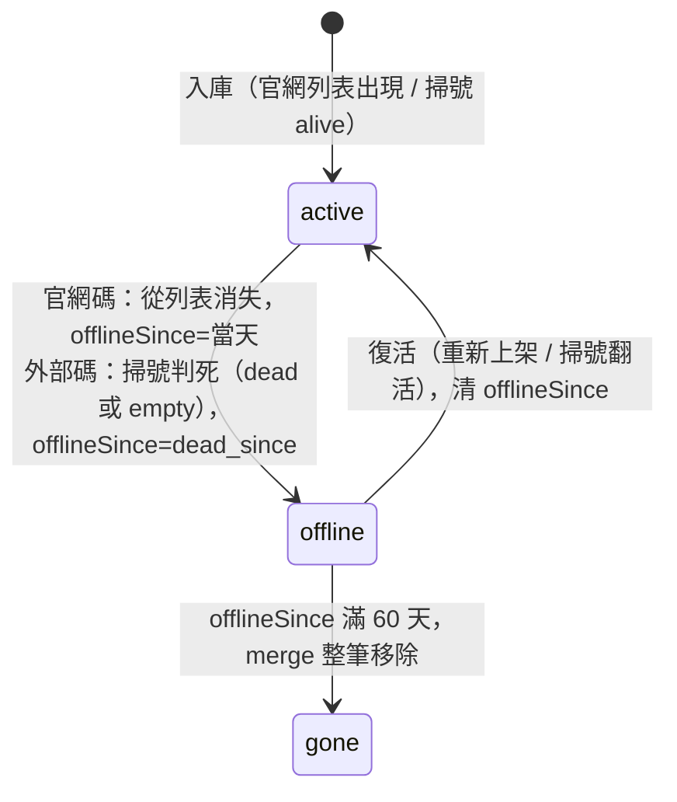

# 資料生命週期分析與新設計報告

> 日期：2026-10-25。這份報告回答三個問題：資料現在怎麼活怎麼死、哪裡壞了、新的設計長什麼樣。
> 前置脈絡：[分析報告](外部碼離線歸檔分析報告.md)（漏洞驗證）、[修復計畫報告](外部碼離線歸檔修復計畫報告.md)（實作方案，顯示層已拍板方案 C）。本文是把兩份報告的共通基礎——生命週期——獨立講清楚。
> 資料基準 2026-10-24（scan_state 718 碼、coupons.js 723 筆；其後每日 CI 會讓數字小幅演進）。

## 現況的生命週期

### 每日管線先跑一次

每天凌晨一條鏈依序跑完（[docs/workflow.md](../../docs/workflow.md) 是權威描述）：

1. **掃號**（[scan.yml](../../.github/workflows/scan.yml)，01:11 dispatch）：confirm 確認既有碼死活 → explore 普查潛在碼位 → sample 抽樣未知號段。產出 `data/scan_state.json`（碼池真相）。
2. **建站**（[update.yml](../../.github/workflows/update.yml)）：build_coupons 抓官網列表 → ingest_external 併入外部碼 → enrich_official 補全官方碼 → gen_sitemap 產 sitemap。產出 `public/coupons.js`（網站資料）。
3. **部署**（deploy-pages.yml）：npm build 上 GitHub Pages。

關鍵認知：**死活的真相有兩個來源**。官網碼的真相是官網促銷頁列表（在不在列表上）；外部碼的真相是掃號對官網驗證端點的探測（scan_state 的狀態）。coupons.js 只是這兩個真相的投影。

### 掃號端：碼池狀態機

[scan_state.json](../../data/scan_state.json) 裡每個碼有三種狀態，轉移全部由每日 confirm/explore 驅動：

| 轉移 | 觸發 | 位置 |
|---|---|---|
| 新碼入池 → 活 | explore/sample 掃到 M1 驗證成功，補 step_2 內容 | [merge_alive_records](../../script/scan/coverage_sync.py#L33-L63) |
| 活 → 死 | confirm 探測 M1 失敗，記 `dead_since` 開始七天觀察 | [daily.py 活轉死](../../script/scan/daily.py#L183-L191) |
| 死 → 活 | 觀察期內 M1 復活，清 `dead_since`、當場補 step_2 | [daily.py 復活](../../script/scan/daily.py#L229-L257) |
| 死 → 退役 | `dead_since` 滿 7 天未復活，狀態改 empty（`dead_since` 保留） | [daily.py 退役](../../script/scan/daily.py#L258-L268)，閾值 [DEAD_TO_EMPTY_DAYS=7](../../script/scan/daily.py#L44) |
| 退役 → 活 | explore 持續盯退役碼，M1 再起就翻活 | [explore 排除集](../../script/scan/daily.py#L296-L298) 只排除當日已探者 |
| 探測失敗 | 網路錯誤/熔斷記 unknown，**狀態不變**——傳輸失敗不算死 | [probe_batch](../../script/scan/daily.py#L53) |

這台狀態機本身是健康的：狀態轉移有觀察期、有復活路徑、退役保留死亡日。紀錄永不刪除（碼池只進不出，目前 718 碼、約 13MB——這是刻意的歷史留存，不是漏洞）。

### 網站端：官網碼的狀態機

官網碼的生死由 [build_coupons 的 merge()](../../script/site/build_coupons.py#L87-L145) 每日對帳官網列表，是一台完整的機器：

| 轉移 | 觸發 | 位置 |
|---|---|---|
| 新碼 → active | 出現在官網列表，firstSeen=今天 | [merge 新碼](../../script/site/build_coupons.py#L114-L117) |
| active 續期 | 仍在列表，lastSeen=今天 | [merge 更新](../../script/site/build_coupons.py#L118-L127) |
| active → offline | 從列表消失，offlineSince=當天 | [merge 下架](../../script/site/build_coupons.py#L137-L142) |
| offline → active | 重新上架，清 offlineSince | [merge 復活](../../script/site/build_coupons.py#L120-L123) |
| offline → 刪除 | offline 超過 60 天整筆移出 coupons.js | [60 天清除](../../script/site/build_coupons.py#L99-L105)，`KEEP_OFFLINE_DAYS=60` |

### 網站端：外部碼的狀態機——只有半台

[ingest_external.py](../../script/site/ingest_external.py#L132-L135) 只實作了上表的前兩列：state=alive 的碼每日 upsert 成 active。**後三列全部缺席**：

- state=dead 或 empty 的碼**連迴圈都進不去**，舊條目原封不動，status 永遠 active、lastSeen/verifiedAt 凍結。
- merge 那邊[刻意放過外部碼](../../script/site/build_coupons.py#L132-L136)（註解寫明死活交給掃號端），於是沒有人補這個缺口。
- [復活翻回的代碼](../../script/site/ingest_external.py#L154-L158)存在但永遠不會觸發（因為永遠不會有 offline 的外部碼）；60 天清除對外部碼形同虛設（因為永遠不會 offline）。

## 問題分析

### 核心缺陷只有一個

**外部碼在 coupons.js 端沒有死亡轉移。** 掃號端早就判死退役的碼，網站端永遠顯示 active。機器不是壞了，是半台機器上線——ingest_external 寫下「只收活碼」時，退休路徑從未被接上。

### 衍生影響

以 10-24 基準量化（細節與驗證在[分析報告](外部碼離線歸檔分析報告.md)）：

- **38 筆殭屍**：使用者看得到、搜尋搜得到、點「前往訂購」撲空。最老的 31 筆 dead_since=09-30（月底過期潮），已當殭屍 25 天（git 取證 26910 自 09-30 commit 起零改動）。
- **統計失真**：全站「active 694」裡有 38 筆是死的。
- **sitemap 污染**：[gen_sitemap](../../script/site/gen_sitemap.py#L32) 只收 active，38 張死碼深連結全部餵給搜尋引擎。
- **檔案單調成長**：外部碼永不離線 → 永不觸發 60 天清除 → coupons.js 的外部碼區只進不出。
- **深連結語意錯**：就算未來標了 offline，[橫幅](../../src/components/CouponDetail.tsx#L131-L138)寫死「已從官網下架」，對掃號判死的外部碼語意不符。

### 三個邊界缺陷

分析過程發現三個獨立的小問題（[分析報告的新發現](外部碼離線歸檔分析報告.md)節），新設計必須繞過或吸收它們：

1. **dead 永久卡死**：15 筆 09-04 遺留 dead 紀錄缺 `dead_since`，[daily.py:259 的 fallback](../../script/scan/daily.py#L259) 讓退役條件永遠差一天——每天白探測、永不退役。今天不修（掃號端另一條管線），記錄於 todo。
2. **復活不清殘留**：[merge_alive_records](../../script/scan/coverage_sync.py#L47-L52) 翻活時不清舊 `dead_since`，活碼可能帶著死亡日欄位。新規則因此**只看 status，絕不看 dead_since 存在與否**。
3. **state.lastSeen 語意陷阱**：它只在入庫時更新，confirm 每日確認活碼並不刷新（26910 的 state.lastSeen=09-05，實際活到 09-30）。新規則**不使用 state.lastSeen** 推算任何時點。

## 新設計

### 設計原則

一句話：**coupons.js 的每一筆 status 都由「對真相來源每日對帳」產生，兩種來源、一台狀態機。**

- 官網碼的真相 = 官網列表（build_coupons 已在對帳，不動）。
- 外部碼的真相 = scan_state（ingest_external 補上對帳——本設計的新增部分）。
- 下線、清除、復活在 coupons.js 端**統一語意**：offline + offlineSince + 60 天 + 翻回，不分來源。

### 統一後的券狀態機



兩種來源共用同一台機器，量測語意也完全相同：**都是每日對真相來源查一次死活，並在偵測到的同一條鏈裡標記**——官網碼由 build 偵測（列表消失）當輪標記，外部碼由掃號偵測（M1 判死）後同鏈的 ingest 標記。兩者記的都是「偵測當天」（外部碼即 dead_since；回填它同時保證修復上線時點不造成日期漂移）。差異只剩偵測器不同；掃號端的七天觀察期從此純粹是池內機制，不外溢到展示。

### 外部碼的對帳規則

ingest 每日對 coupons.js 裡每筆 `source=verified-external` 拿 scan_state 對帳，三條：

1. state=**dead 或 empty** → 標 offline，offlineSince=dead_since。**展示上兩者不做區分**（2026-10-25 拍板）——它們的差異只是掃號池的內部設計預留：dead 是七天觀察窗（給掃號端自己盯復活用），empty 是觀察結束後的退役歸檔；對網站而言兩者都是「掃號已判死」，理應同日以同一種方式下架。缺 dead_since 的遺留形狀（09-04 那 15 筆，皆不在 coupons.js）退取券的 lastSeen、再沒有取當天。
2. state=**alive** → 既有迴圈照常刷新 active。
3. state**查無紀錄** → 不動（無證據不判死；今日 0 筆）。

觀察期內死而復活的碼，網站會如實波動：判死當天變殘影、復活隔天翻回。翻回由既有路徑自動處理，屬自癒——觀察期從此純粹是掃號池的內部機制，不再外溢到展示層。

特性：**冪等**（offlineSince 回填判死當天，每日重跑同值）；**只看 status**（免疫復活殘留）；**不讀 state.lastSeen**（免疫語意陷阱）；**只碰 verified-external**（官網碼歸 build 管，職責不重疊）。

附註：[docs/todo.md](../../docs/todo.md) `6a7ec13` 條目 2 修法方向寫的「`dead` 走 7 天寬限期」已被本決定取代，實作時一併修正該行。

實作上這段走訪必須放在 ingest [早退](../../script/site/ingest_external.py#L136-L138)之前（否則活碼清零那天功能失效），細節見[修復計畫報告](外部碼離線歸檔修復計畫報告.md)。

### 一個碼的完整一生

以 26910（長榮航空輕鬆）走新系統——判死與下架發生在同一天：

| 日期 | 掃號端 | 網站端 |
|---|---|---|
| 09-05 | explore 掃到活碼入池 | ingest 上架，active |
| 09-05～09-29 | confirm 每日確認活著 | 每日刷新 active |
| 09-30 | M1 判死，dead_since=09-30，觀察期開始 | 同一條鏈的 ingest 對帳：標 offline、offlineSince=09-30；殘影卡「已失效 · 自 09-30」上線 |
| 09-30～10-07 | 觀察期：confirm 每日回頭重探 | 殘影照常顯示；期間復活的話隔天翻回 active |
| 10-07 | 死滿 7 天，退役 empty | 顯示不變——展示上 dead 與 empty 無差異 |
| 10-07～11-29 | explore 持續盯復活 | 殘影卡在列表、參與搜尋、無訂購鈕、不進 sitemap |
| 11-29 | — | 死滿 60 天，merge 整筆移除，殘影消失 |
| 任一時點復活 | 翻回 alive | 隔天 ingest 翻回 active，殘影復原 |

### 顯示與外圍的配合

- 列表採**方案 C 殘影內嵌**（2026-10-25 原型實測拍板）：offline 券灰化、角標失效日、排活碼之後、無訂購鈕、參與搜尋篩選。官網下架券同時從「完全隱形」改為殘影（行為改變，原型所見即所得）。改動落在 [filterCoupons](../../src/lib/filter.ts#L53-L77)、[sortCoupons](../../src/lib/filter.ts#L80-L105)、[CouponCard](../../src/components/CouponCard.tsx#L60)。
- 橫幅按來源分支：官網碼「已從官網下架」；外部碼「掃號已確認失效（自 X 起）」（[CouponDetail](../../src/components/CouponDetail.tsx#L131-L138)）。
- sitemap 維持只收 active：死碼退出搜尋引擎，但站內殘影可見——兩者語意不同，不跟著列表走。
- 統計維持只算 active（activeCount、[collectTags](../../src/lib/filter.ts#L108-L117)）。

### 不動的部分

掃號管線（scan.yml、daily.py、scan_state 結構）一個字不改——它的狀態機本來就是對的。官網碼路徑不改。60 天清除與復活翻回的代碼本來就在，只是第一次對外部碼生效。

### 風險與退路

- 對帳誤判的模擬結果零誤離線（10-24 全量重算）；即使未來誤標，隔天掃號翻活後 ingest 自動翻回——**自癒型風險**。
- 最壞情況退路：整個修復是單一 commit，revert 後隔日 CI 重建舊行為；scan_state 全程未被寫過，無不可逆。

## 驗證方式

```cmd
.venv\Scripts\python.exe exp_prob\2026-10-25_search-offline-archive\probe_fix_sim.py
```

上線後重跑：stale active 歸零、誤離線為 0、60 天清除日分佈（11-29×31、12-09/10/13×7）即為新生命週期的第一批足跡。
